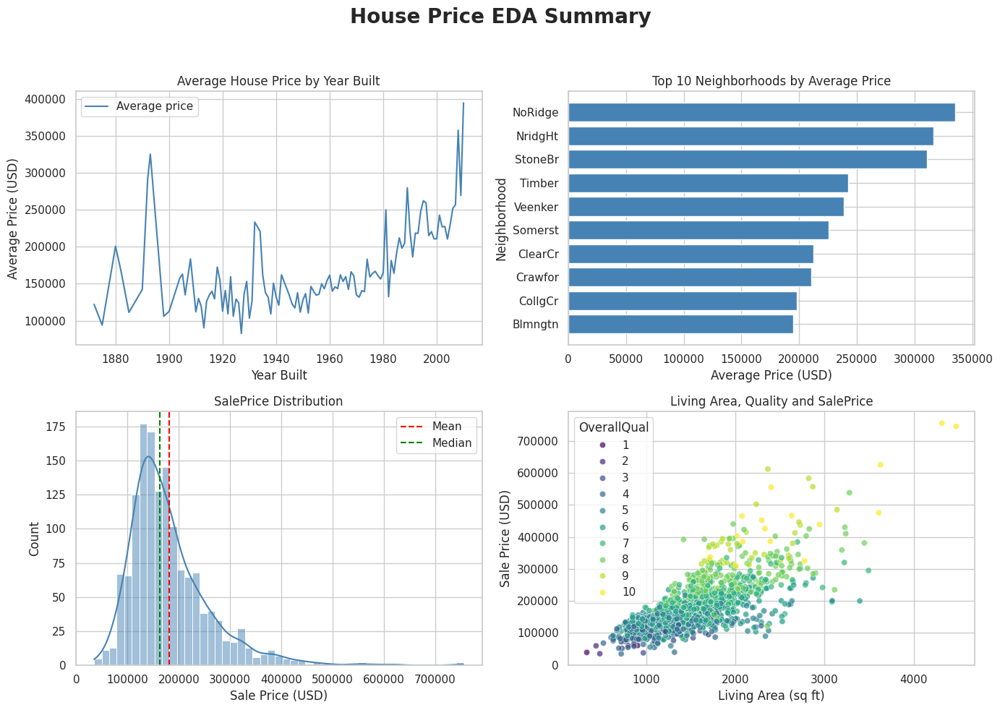

# Ames Housing - Exploratory Data Analysis

## Project Overview

This project performs Exploratory Data Analysis (EDA) on the Ames Housing Dataset to understand house prices, identify important features, analyse data distributions and detect outliers using Python.

The project focuses entirely on data analysis and visualization without using machine learning.

## Dataset

- Source: Kaggle - House Prices: Advanced Regression Techniques
- Dataset: `train.csv`
- Total Records: 1,460
- Total Columns: 81
- Target Variable: `SalePrice`

## Project Objectives

- Understand the distribution of house prices.
- Identify features strongly correlated with SalePrice.
- Analyse the relationship between house quality, location and price.
- Detect and analyse outliers.
- Handle missing values and improve data quality.
- Summarize important findings through visualizations.

## Technologies Used

- Python
- Pandas
- NumPy
- Matplotlib
- Seaborn
- SciPy
- Google Colab

## EDA Workflow

1. Data Loading and Understanding
2. Variable Classification
3. Descriptive Statistics
4. Distribution Analysis
5. Correlation and Covariance Analysis
6. Scatter Plots and Pair Plots
7. Correlation Heatmap
8. Outlier Detection using IQR and Z-score
9. Data Cleaning and Quality Checks
10. Final Dashboard and Insights

## Key Findings

- House prices follow a right-skewed distribution.
- Log transformation significantly reduces the skewness of SalePrice.
- OverallQual has the strongest correlation with SalePrice (0.791).
- GrLivArea also shows a strong positive correlation with SalePrice (0.709).
- Higher-quality houses generally have higher sale prices.
- House prices vary significantly across neighborhoods.
- Two unusually large houses with low sale prices were excluded from the cleaned dataset.
- After cleaning, the dataset contains 1,458 records with no remaining missing values.

## EDA Dashboard

The final dashboard summarizes the major findings through four visualizations:

- Average house price by construction year
- Top 10 neighborhoods by average sale price
- House price distribution
- Living area vs. sale price based on overall quality

## Repository Structure

- `Ames_Housing_EDA.ipynb` - Complete EDA notebook
- `train.csv` - Housing dataset
- `eda_dashboard_real.png` - Final visualization dashboard
- `README.md` - Project documentation
## How to Run

1. Download the notebook and dataset.
2. Open the notebook in Google Colab.
3. Upload the dataset and update the file path if required.
4. Run all cells sequentially.

## Conclusion

This project demonstrates the complete exploratory data analysis workflow, from understanding raw data to cleaning, statistical analysis and visualization.

The analysis highlights overall quality, living area and neighborhood as important features associated with house prices. These relationships indicate correlation, not necessarily causation.

## Dataset Source

[House Prices - Advanced Regression Techniques](https://www.kaggle.com/competitions/house-prices-advanced-regression-techniques/data)
